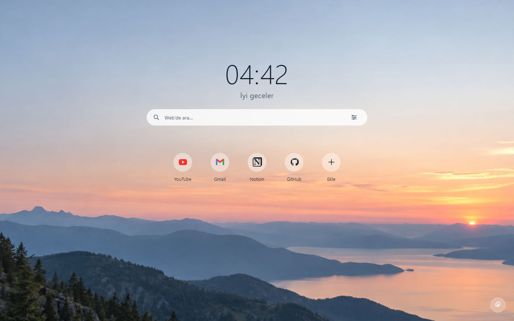

<p align="center"></p>

# plugg

Modül yapısıyla birçok yardımcı özellik içerir.

[](https://github.com/burakburaq/Plugg/actions/workflows/ci.yml)
[](LICENSE)

Türkçe arayüzlü, koyu temalı bir tarayıcı araç kutusu. Eklentilerini yönet,
sekme sesini ayarla, sayfaya çizim yap veya yeni sekmeni özelleştir.
İhtiyacın olan modülleri seç; diğerleri pasif kalsın.



## Neler var?

| Modül | Özellikler |
| --- | --- |
| Extension Manager | Eklentileri aç/kapat, aktif/pasif veya alfabetik sırala. |
| Volume Booster | Sekme başına 0.0–6.0 ses seviyesi, altı bantlı EQ ve hazır ayarlar. |
| Video Araçları | Video üstü zoom, ekranı doldurma, germe, konum ve görüntü ayarları. |
| Yeni Sekme | Taşınabilir ve boyutlandırılabilir saat, arama, site kısayolları, yapılacaklar, notlar, hava durumu ve odak süresi. |
| Sayfaya Çizim | Kalem/silgi, URL'ye kayıt, isteğe bağlı geri yükleme, özel kayıt ve PNG dışa aktarma. |
| Klavye Kısayolları | Son kullanılan sekmeye dön, sağ/sol sekmeye geç, özel işlemler ve metin alanı koşulları. |
| Koyu Mod | Dark Reader ile site renklerini değiştir, görünümü ayarla ve site hariç tut. |
| Sayfa Fotoğrafı | Tüm sayfayı tek PNG olarak indir. |
| Yazı Tipi Bulucu | İmleç altındaki metnin CSS font ailesini, boyutunu ve kalınlığını göster. |
| Renk Seçici | Ekrandan renk al, HEX/RGB değerini kopyala. |
| Sekme Grupları | Aynı domaindeki sekmeleri grupla. |
| Sayfa Editörü | Sayfadaki metinleri geçici olarak düzenle. |
| QR Oluşturucu | **Tasarım aşamasında.** QR üretimi ve indirme henüz yok. |

İlk kurulumda **Extension Manager** ve **Volume Booster** aktiftir. Ana menüdeki
çarktan diğer modülleri aktifleştirebilir ve sürükleyerek sıralayabilirsin.
Değişiklikler otomatik kaydedilir. Kodun önceden yüklenmesi modülü çalıştırmaz.

## Tarayıcı desteği

Ana hedef **Chrome 116+**. Firefox çıktısı da üretilir; tüm modüller için
Chrome ile eşdeğer destek henüz sağlanmamıştır.

| Özellik | Chrome | Firefox 128+ |
| --- | --- | --- |
| Video Araçları | Doğrulandı | Doğrulandı |
| Volume Booster | Desteklenir | Desteklenmez |
| Sayfa Fotoğrafı | Desteklenir | Desteklenmez |
| Renk Seçici | Etkin sekme erişimi gerekir | Tarayıcı özel sayfalarında kullanılamaz |
| Diğer modüller | Chrome için geliştirildi | Tam uyumluluk doğrulanmadı |

Video Araçları standart HTML videolarını hedefler; ayrı iframe ve kapalı
shadow DOM oynatıcıları kapsam dışındadır. Kare interpolasyonu bulunmaz.
Tarayıcının dahili sayfalarında ve eklenti mağazalarında sayfa araçları çalışmaz.

## Kurulum

Gereksinim: **Node.js 22.12+ (22 serisi) veya 24+** ve npm.

```sh
git clone https://github.com/burakburaq/Plugg.git
cd Plugg
npm ci
npm run build
```

Chrome'da `chrome://extensions` → **Geliştirici modu** → **Paketlenmemiş öğe
yükle** yolunu izleyerek **dist-chrome** klasörünü seç. Yeni derlemeden sonra
eklenti kartındaki **Yeniden yükle** düğmesi yeterlidir.

Firefox için:

```sh
npm run build:firefox
```

`about:debugging#/runtime/this-firefox` → **Geçici eklenti yükle** üzerinden
**dist-firefox/manifest.json** dosyasını seç. Bu geçici kurulum tarayıcı yeniden
başlatılınca kaldırılır; paket imzalı mağaza dağıtımı değildir.

[GitHub Actions](https://github.com/burakburaq/Plugg/actions) içindeki başarılı
derlemelerin `plugg-chrome` ve `plugg-firefox` çıktıları da indirilebilir.
İndirdiğin arşivi açtıktan sonra ilgili klasörü yükle.

## Geliştirme

```sh
npm ci
npm run dev
```

Chrome'a **dist-chrome.dev** klasörünü yükle ve geliştirme sunucusunu açık tut.
React arayüz değişiklikleri Vite/CRXJS üzerinden otomatik güncellenir; manifest
ve izin değişiklikleri eklentiyi yeniden yüklemeyi gerektirebilir.
Geliştirme ve üretim kopyalarını aynı anda etkinleştirme.

| Komut | Sonuç |
| --- | --- |
| `npm test` | Node testlerini çalıştırır. |
| `npm run build` | Chrome üretim çıktısı: `dist-chrome`. |
| `npm run build:firefox` | Chrome ve Firefox çıktıları: `dist-chrome`, `dist-firefox`. |
| `npm run dev` | Chrome hot reload çıktısı: `dist-chrome.dev`. |

Kaynak kod React/JavaScript'tir. Modül ekranları `components/modules/`, ortak
arayüz parçaları `components/`, tarayıcı işlemleri `modules/` altında bulunur.
CI, `main` gönderimlerinde ve pull request'lerde temiz kurulum, test ve iki
tarayıcı için derleme yapar. Otomatik testler tarayıcı içi uyumluluk testlerinin
yerini tutmaz.

## Veriler ve izinler

Ayarlar, görevler ve çizimler tarayıcının yerel eklenti hafızasında saklanır.
Son açılan modüller ve sekme geçmişi oturum hafızasını kullanır.
Ses kaydedilmez veya dışarı gönderilmez; analiz servisi eklenmemiştir.

`management` eklenti yönetimi, `activeTab`/`scripting` sayfa araçları,
`tabCapture`/`offscreen` ses işleme içindir. Tam sayfa görüntüsü ve sekme
gruplama ek izinleri kullanım sırasında ister. Koyu mod ve otomatik çizim
geri yükleme için isteğe bağlı site erişimi gerekir.

Hava durumu açıldığında seçtiğin şehir/koordinatlar Open-Meteo'ya, arama
gönderildiğinde sorgun Google'a iletilir. Koyu mod gerektiğinde sitenin CSS ve
görsellerini yükler. Arka plan görseli paket içindedir.

## Belgeler ve lisans

- [Ayrıntılı kullanım ve geliştirme](docs/usage.md)
- [Bağımlılıklar, görseller ve servis kaynakları](THIRD_PARTY_NOTICES.md)
- [Görsel kaynak notu](assets/newtab-background.md)
- [MIT lisansı](LICENSE) — proje kaynak kodu. Bağımlılık ve görsel bildirimleri ayrıca korunur.

Hata bildirirken tarayıcı sürümünü, ilgili modülü ve sorunu yeniden oluşturma
adımlarını [Issues](https://github.com/burakburaq/Plugg/issues) sayfasına ekleyebilirsin.
